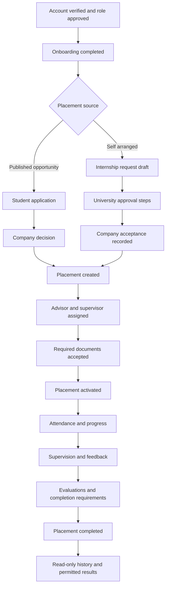
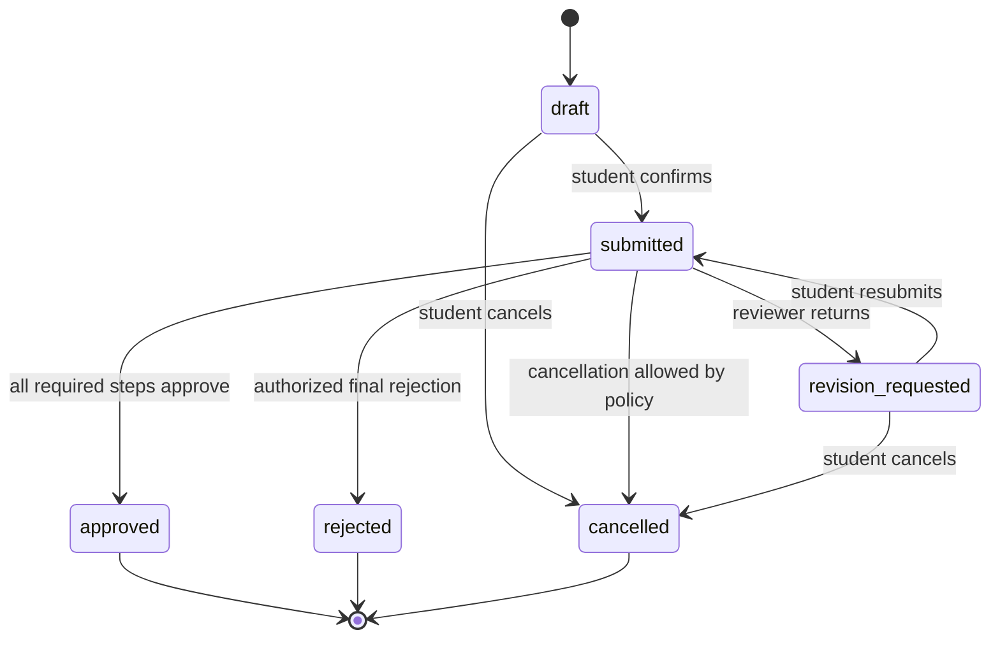
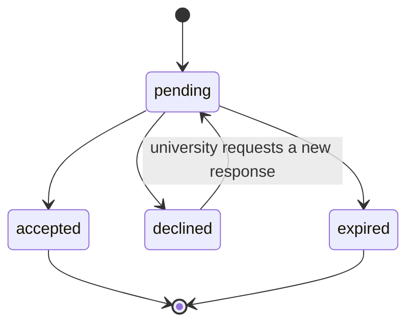
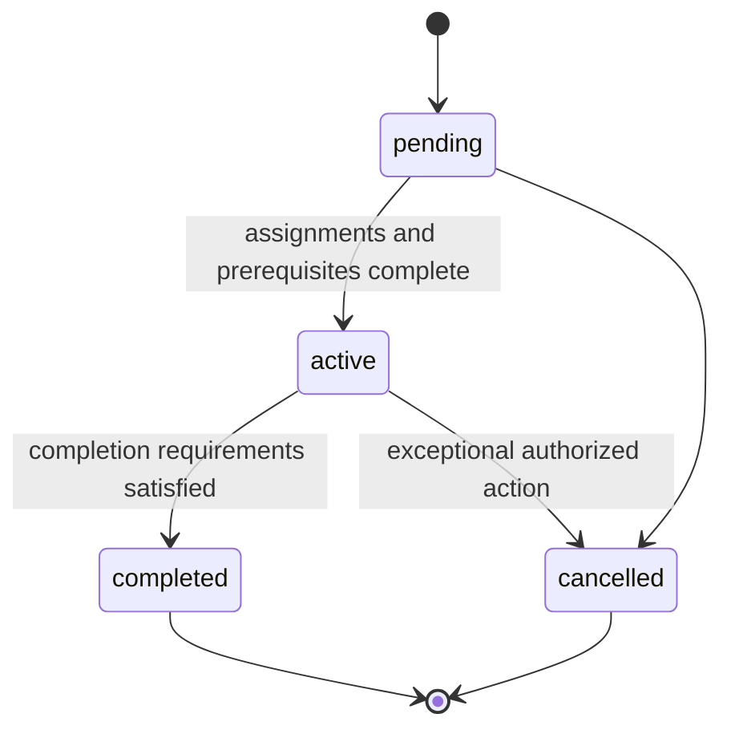
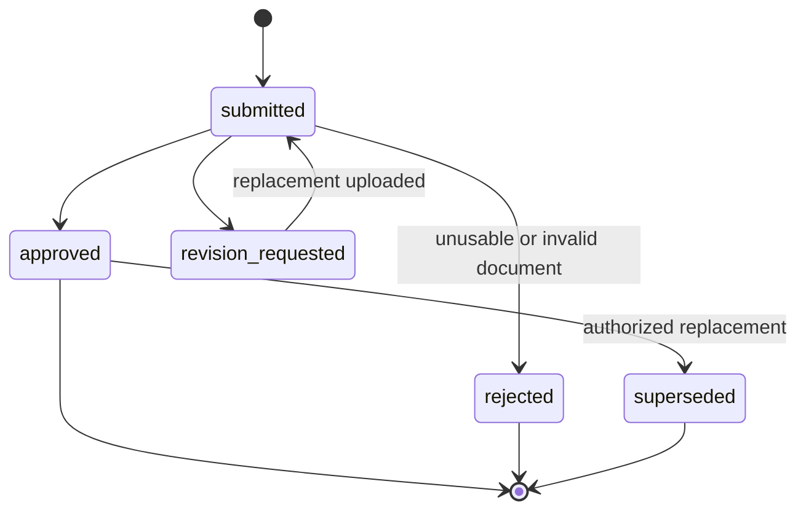
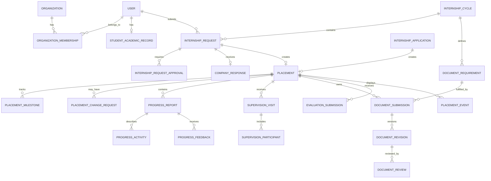

# Current release workflow and data design

## 1. Purpose

This design completes the workflow foundation needed for the Trainy research
release without adding official-document generation. It covers the four
research participant groups: students, university advisors, university staff,
and workplace supervisors.

The release succeeds when each participant can identify their next action,
complete the relevant task, see who owns the next step, and recover from a
returned or failed action without coordinating the core workflow outside
Trainy.

## 2. Scope

### Included

- Role-aware current-state and next-action presentation.
- Self-arranged internship request drafts and approval progress.
- Company acceptance recording for self-arranged placements.
- Placement assignment, activation, completion, and cancellation.
- Placement-change requests with immutable before-and-after references.
- Attendance, leave, and correction workflows already present in the system.
- Structured progress entries and reviewer feedback.
- Supervision planning and visit records.
- Configurable evaluation schemes already present in the system.
- Document requirements, upload, review, resubmission, and history.
- User-visible placement timeline separate from the security audit log.
- Notifications for actionable transitions and approaching deadlines.

### Deferred

- Automatic population of official PDF or Word forms.
- Official document numbering and issue-date policy.
- Digital or image signatures.
- Template editing and template-version administration in the UI.
- Print preview and print-ready document generation.
- Automated migration of fields out of previously uploaded documents.

## 3. End-to-end journey

### Student

1. Complete profile and select an available internship path.
2. Save an application or self-arranged request as a draft.
3. Review a submission summary and confirm formal submission.
4. Respond to revision requests without losing prior decisions or feedback.
5. See whether the university or workplace currently owns the next action.
6. Upload required completed forms and replace only documents returned for
   revision.
7. During an active placement, record attendance and structured progress.
8. Submit a placement-change request when a workplace must change.
9. Complete student-owned evaluations and view only results allowed by policy.
10. After completion, retain read-only access to the timeline and documents.

### University advisor

1. Review requests only within the advisor's authorized academic scope.
2. Approve or request revision with a required reason.
3. Monitor assigned students and overdue or returned work.
4. Review attendance exceptions and progress reports when assigned.
5. Schedule and record supervision visits.
6. Complete assigned evaluation components.

### University staff

1. Configure the active internship cycle and its deadlines.
2. Complete staff approval steps and maintain placement assignments.
3. Define required document codes for each track and stage.
4. Review uploaded official forms without generating their contents.
5. Review placement-change requests within authorized responsibility.
6. Monitor incomplete milestones and complete eligible placements.

### Workplace supervisor

1. Access only placements assigned to the supervisor's company and user.
2. Record the company's acceptance or rejection when authorized.
3. Review relevant attendance exceptions and progress entries.
4. Participate in supervision records when applicable.
5. Complete assigned workplace evaluation components.

## 4. State models

### 4.1 Internship request

The existing request status requires an additive `draft` state. Approval-step
records remain the authoritative record of advisor, program-chair, and center
decisions. Submission and every decision must be idempotent and audited.

### 4.2 Company response

An accepted university request does not imply that a company accepted the
student. The company response is a separate fact with its actor, timestamp,
contact snapshot, optional reason, and evidence document.

### 4.3 Placement

Placement changes do not overwrite the original placement history. An approved
change closes or supersedes the prior placement according to policy and creates
or links the replacement placement in one transaction.

### 4.4 Uploaded document

Previously submitted file versions remain immutable. A replacement creates a
new version and retains the review history of the old version.

### 4.5 Structured progress entry

The existing `draft`, `submitted`, `revision_requested`, and `approved` states
remain suitable. Approved entries are immutable. A returned entry is editable
and retains the review that caused the return.

## 5. Domain model

## 6. Data changes

### 6.1 Extend existing entities

#### `internship_request`

- Add `draft` to the status enum.
- Add the company contact position and company address fields already identified
  by the product revision draft.
- Add a client-generated idempotency key or equivalent unique submission guard.
- Do not require approval rows until the request is formally submitted.

#### `progress_report`

- Retain `summary` and `hoursWorked` during migration.
- Add child records for activities, learning outcomes, problems, solutions,
  skills, and evidence references.
- Do not copy approved attendance totals into the report until the aggregation
  policy is confirmed; reference or calculate them instead.

#### `placement_document`

- Preserve current uploaded files and storage keys.
- Replace the single mutable review result with versioned submissions and
  append-only reviews during the document-workflow slice.
- Keep the existing 20 MiB maximum unless an explicit operational decision
  changes it.

### 6.2 Proposed new entities

| Entity                      | Purpose                                                | Important invariants                                                      |
| --------------------------- | ------------------------------------------------------ | ------------------------------------------------------------------------- |
| `internship_cycle`          | University-owned term and workflow window              | Unique organization, track, term, and year                                |
| `company_response`          | Explicit workplace response to a self-arranged request | At most one current response per request; actor and snapshot retained     |
| `placement_change_request`  | Proposed workplace or period replacement               | References immutable prior values; only one pending request per placement |
| `placement_change_approval` | Ordered university decisions                           | Unique request and approval step                                          |
| `placement_milestone`       | Due and completed workflow requirements                | Unique placement and milestone code                                       |
| `progress_activity`         | Structured activity and learning details               | Owned by one progress report; immutable after approval                    |
| `progress_feedback`         | Append-only reviewer feedback                          | Actor and timestamp required                                              |
| `supervision_visit`         | Planned and completed supervision event                | Belongs to one placement; planned time precedes completion time           |
| `supervision_participant`   | Advisor, supervisor, or attendee snapshot              | Unique visit and participant                                              |
| `document_requirement`      | Document expected for a track/stage                    | University and cycle scoped; code is stable                               |
| `document_submission`       | Logical required document for a placement              | Unique placement and requirement                                          |
| `document_revision`         | Immutable uploaded file version                        | Monotonic version; storage key never reused                               |
| `document_review`           | Append-only decision on a revision                     | One terminal decision per reviewer action/idempotency key                 |
| `placement_event`           | User-visible timeline event                            | Contains no secrets; visibility is explicit                               |

### 6.3 Data deliberately deferred

The current release must not add PDF coordinates, PDF field names, rendering
settings, letter numbering, signatory images, or print-layout configuration to
the core workflow tables. Those belong to the future document-automation
boundary.

## 7. Authorization and privacy

### Trust boundaries

- Client requests are untrusted. The server resolves current membership,
  assignment, placement, and workflow state for every mutation.
- Organization membership alone does not grant access to every placement in
  that organization. Access is further limited by role, academic scope, or
  explicit advisor/supervisor assignment.
- Storage keys are never exposed as unauthenticated public paths. Downloads go
  through an authorized server endpoint or short-lived scoped URL.
- File name, MIME type, extension, and file content are independently checked.
- Timeline metadata excludes health data, private contact details, exact GPS,
  tokens, storage paths, and internal security evidence.

### Sensitive data

The official forms contain fields that Trainy's research release does not need
to model, including religion, health details, parent details, height, and
weight. They must not be added merely because a template contains them. Such
fields remain only in a user-supplied official document until a documented
purpose, access policy, retention period, and lawful basis are approved.

### Default access matrix

| Resource              | Student                    | Assigned advisor       | University staff         | Assigned supervisor       |
| --------------------- | -------------------------- | ---------------------- | ------------------------ | ------------------------- |
| Own placement         | Read                       | Read                   | Authorized scope         | Read                      |
| Progress entry        | Create/read own            | Review                 | Authorized read          | Review when policy allows |
| Attendance            | Create/read own            | Authorized read/review | Authorized read/review   | Review assigned placement |
| Uploaded document     | Upload/read permitted      | Review when assigned   | Review                   | Read only when required   |
| Supervision visit     | Read                       | Create/update          | Authorized read          | Read/acknowledge          |
| Evaluation            | Assigned component only    | Assigned component     | Policy-defined           | Assigned component only   |
| Security audit        | No                         | No                     | Restricted operator only | No                        |
| User-visible timeline | Permitted placement events | Permitted events       | Authorized scope         | Permitted events          |

## 8. API boundaries

The final route naming should follow existing Hono module conventions. The
design requires these capabilities rather than prescribing exact URLs:

- Internship cycle list and active-cycle lookup.
- Request draft create/update, submit, revise, cancel, and status detail.
- Company response record and view.
- Placement change request, review, and outcome.
- Structured progress draft, submit, review, and resubmit.
- Supervision plan, visit record, and participant acknowledgement.
- Document requirement list, versioned upload, review, and authorized download.
- Placement timeline with visibility filtering and cursor pagination.

Consequential POST operations use idempotency keys. Conflict responses identify
the current state without exposing restricted records. File endpoints enforce
size, content-type, authorization, and safe response headers.

## 9. Migration and rollout

### Slice 1: Request and dashboard correctness

- Add request drafts and missing company fields.
- Add submission confirmation and idempotency.
- Correct active/history grouping and next-action presentation.

### Slice 2: Cycle, milestones, and timeline

- Add internship cycles and placement milestones.
- Add user-visible placement events from explicit domain actions.
- Backfill only events derivable with certainty; do not fabricate actors or
  timestamps.

### Slice 3: Company response and placement change

- Add company-response recording.
- Add placement-change request and approval flow.
- Preserve the original placement and source request/application references.

### Slice 4: Structured progress and supervision

- Add structured progress children while retaining existing summaries.
- Add supervision plan and visit records.

### Slice 5: Document checklist and versioned upload

- Add document requirements by cycle and track.
- Migrate current placement documents into logical submissions with revision 1.
- Keep downloadable templates as static, staff-managed repository assets for
  this release.

### Slice 6: Evaluation completion and research release verification

- Configure Normal and CWIE schemes from confirmed institutional rules.
- Verify end-to-end tasks for all four research participant groups.

Each slice uses an additive migration, supports rollback before destructive
cleanup, and is hidden behind a route or feature gate until its backend,
authorization tests, frontend, and documentation are complete.

## 10. Verification

Each implementation slice requires:

- Unit tests for transitions, validation, and idempotency.
- PostgreSQL integration tests for constraints and transactions.
- Cross-user, cross-role, and cross-tenant denial tests.
- Upload tests for size, type mismatch, malformed files, unauthorized download,
  and replacement/version behavior.
- Client tests for loading, empty, validation, error, read-only, confirmation,
  returned-for-revision, and success states.
- Type checks, lint, formatting, production builds, and the repository test
  suites.
- The repository-required local OWASP-aligned black-box pass after other checks
  pass for every security-relevant implementation slice.

## 11. Current-release completion criteria

- A participant can identify the current state, next action, owner, and deadline.
- A self-arranged request can be drafted, submitted, returned, resubmitted,
  approved, and matched to an explicit company response.
- A placement cannot activate until required assignments and prerequisites pass.
- Progress and supervision evidence are stored as structured, reviewable data.
- Required official forms can be downloaded, uploaded, reviewed, replaced, and
  found in history without automatic generation.
- Every consequential transition is authorized, idempotent, notified, and
  represented in both security audit and appropriately filtered user history.
- Normal and CWIE track differences remain configurable and are not inferred
  from a file name.

## 12. Open policy decisions

These decisions may change configuration but do not block the design:

1. Maximum number of simultaneous active self-arranged requests per student.
2. Whether workplace addresses must be structured or initially stored as a
   single postal address.
3. Which uploaded document types workplace supervisors may view.
4. Retention periods for files, contact snapshots, precise location evidence,
   and user-visible events.
5. Whether supervision requires a fixed number of visits for every track or a
   cycle-specific requirement.
