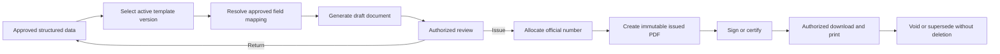

# Future official document automation

## 1. Status

This work is intentionally deferred beyond the current research release. The
official forms under `templates/` are accepted as the latest available forms,
but this release will not automatically populate, issue, preview, or print
them.

The current workflow remains compatible with this future work by using stable
document requirement codes, versioned uploads, immutable review history, and
placement-linked data.

## 2. Future outcome

## 3. Planned capabilities

### Template registry

- Register Normal and CWIE template codes.
- Keep the original source file and checksum.
- Record effective dates and retired versions.
- Identify the organization that owns the template.
- Retain every version used to create an issued document.

### Field mapping

- Map stable semantic keys such as `student.fullNameTh` to a version-specific
  PDF field or document placeholder.
- Validate duplicate or unnamed PDF fields before activation.
- Preview a mapping with synthetic data that contains no real personal data.
- Store mapping configuration outside core placement tables.

### Generation

- Generate deterministic draft documents from an explicit data snapshot.
- Record the input snapshot, template checksum, generator version, and output
  checksum.
- Never silently regenerate an issued document when source data later changes.
- Produce a new document version instead.

### Numbering and issuing

- Configure numbering by organization, document series, and academic year.
- Allocate numbers transactionally with no reuse after issue or voiding.
- Separate draft generation from the authorized issue action.
- Record issuer, issued timestamp, and policy version.

### Signature and certification

- Decide separately whether the institution permits uploaded signature images,
  cryptographic signatures, external signing services, or manual signing.
- Never store a reusable signature image in a broadly accessible template.
- Require explicit authority for each signatory and document type.
- Preserve the unsigned and signed outputs where policy requires both.

### Preview, print, and delivery

- Render representative Thai documents and inspect every page for missing
  glyphs, clipping, overflow, stale form appearances, and misplaced fields.
- Provide print-ready output only from an issued immutable version.
- Authorize download by placement, organization, role, and document visibility.
- Add delivery tracking only if the institution needs email or external
  transmission records.

## 4. Proposed future entities

| Entity                      | Purpose                                                |
| --------------------------- | ------------------------------------------------------ |
| `document_template`         | Stable organization-owned template identity            |
| `document_template_version` | Immutable source file, checksum, and effective dates   |
| `document_template_field`   | Semantic-to-physical field mapping                     |
| `document_generation`       | Draft generation request, snapshot, and outcome        |
| `official_document`         | Logical issued document linked to its workflow subject |
| `official_document_version` | Immutable generated output and checksum                |
| `document_number_series`    | Numbering configuration and next-number boundary       |
| `document_signature`        | Signatory action and verification evidence             |
| `document_delivery`         | Optional authorized delivery record                    |

These entities should link to the current-release `document_requirement` and
placement workflow instead of replacing uploaded-document history.

## 5. Work deferred from the current release

1. Confirm the final mapping between CWIE 01–19 and historical สศ. codes.
2. Normalize duplicate and generic PDF field names.
3. Define the official source-of-truth file for every form code.
4. Confirm letter number, issue date, retention, and voiding rules.
5. Confirm authorized signatories and delegation behavior.
6. Implement template ingestion and validation tooling.
7. Implement field mapping and safe preview.
8. Implement deterministic PDF generation and visual verification.
9. Implement transactional numbering and issue approval.
10. Implement signing only after institutional policy is approved.
11. Add preview, print, download, and optional delivery history.
12. Backfill no historical generated documents unless reliable source snapshots
    are available.

## 6. Entry criteria for the future release

Implementation should begin only when:

- The current workflow and document-upload release is stable.
- Each active form has an owner, code, version, and effective date.
- Official numbering, signing, retention, and regeneration policies are written.
- Representative forms have passed a field-quality audit.
- Durable private file storage and backup/restore are operational.
- The university approves the intended legal effect of generated and signed
  documents.

## 7. Security and privacy requirements

- Generation workers receive the minimum data needed for one document.
- Temporary files are isolated and removed after bounded processing.
- Template and output downloads require server-side authorization.
- Generated files use non-guessable storage keys and safe download headers.
- Logs contain document IDs and outcomes, not document contents or personal
  fields.
- Rendering is resource-bounded and rejects malformed or unexpectedly large
  inputs.
- Signatures, official numbers, and issued outputs are append-only and auditable.
- Sensitive fields found in a template are not automatically added to the
  Trainy domain model.

## 8. Compatibility promise from the current release

The current release must preserve stable document requirement codes, immutable
uploaded revisions, placement and actor references, and explicit workflow
events. With those boundaries, future automation can produce an official
document as another document revision without redesigning the internship
workflow.
